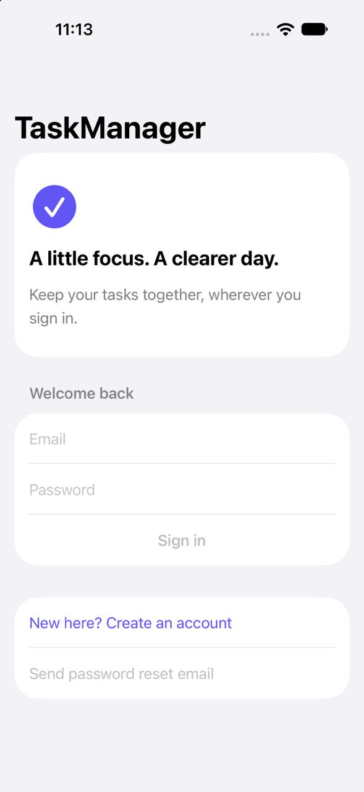
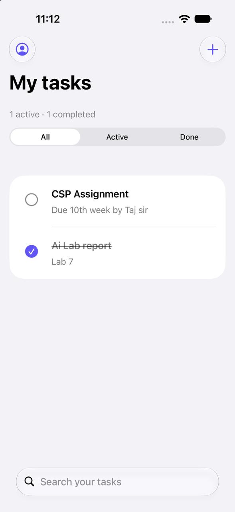
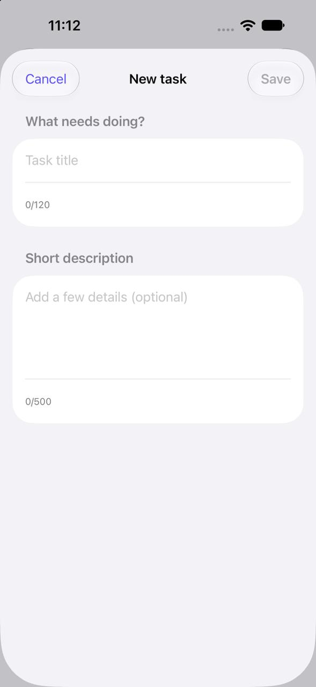
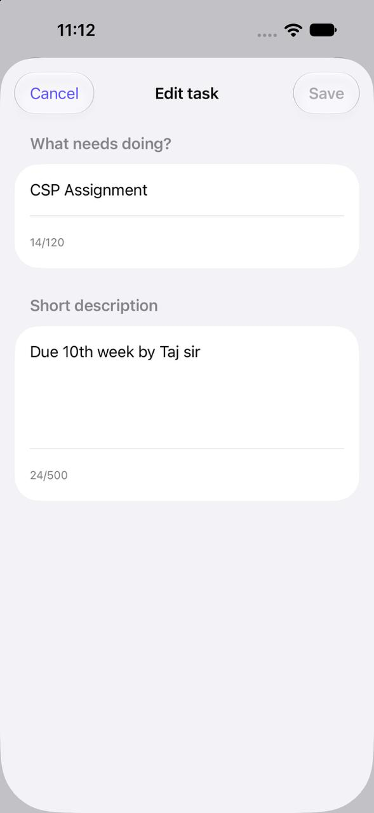
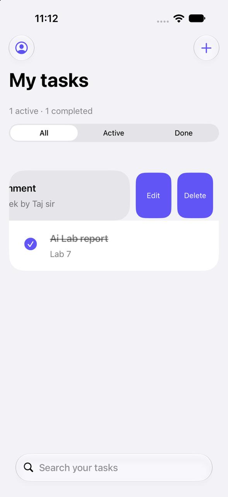

# TaskManager

A native SwiftUI task manager for iPhone and iPad. Sign in with an email and password, organize tasks, and pick up where you left off on another device. Firebase Authentication handles accounts, and Cloud Firestore keeps each account's tasks in sync.

## Screenshots

| Sign in | My tasks | New task |
| :---: | :---: | :---: |
|  |  |  |
| Sign in, create an account, or reset your password. | Search tasks and switch between All, Active, and Done. | Add a title and an optional description. |

| Edit task | Swipe actions |
| :---: | :---: |
|  |  |
| Update an existing task's title and description. | Swipe to edit or delete. Deletion asks for confirmation. |

## Run locally

1. Clone this repository on an Apple silicon Mac with Xcode 16.3 or later.
2. Put your Firebase Apple app's `GoogleService-Info.plist` in `FirebaseConfig/`. The app expects bundle ID `com.rafsan.TaskManager`. Keep the plist outside Git and transfer it separately between machines.
3. For a new Firebase project, enable Email/Password authentication, create the default Firestore database, and publish [the task security rules](firestore.rules). [Firebase setup guide](docs/FIREBASE_SETUP.md)
4. Open `TaskManager.xcodeproj` and let Xcode resolve the packages. Select the **TaskManager** scheme and an iOS 17 or later simulator, then press **Run**.

The project targets ARM64 for device and simulator builds. Firebase Apple SDK 12.19.3 and its resolved dependencies are recorded in the project.

## How it works

The app restores the Firebase sign-in session at launch. Each signed-in user gets a live task list from `users/{uid}/tasks/{taskID}`. Tasks have a title, optional description, completion state, and server timestamps. Tap the circle next to a task to complete or reopen it.

Firestore rules enforce account ownership and validate task fields. The SwiftUI views handle loading, empty lists, and errors, and use system colors and Dynamic Type.

- [SwiftUI app source](TaskManager/)
- [Firebase and Mac setup](docs/FIREBASE_SETUP.md)
- [Local checks](docs/TESTING.md) and [validation record](docs/VALIDATION.md)
